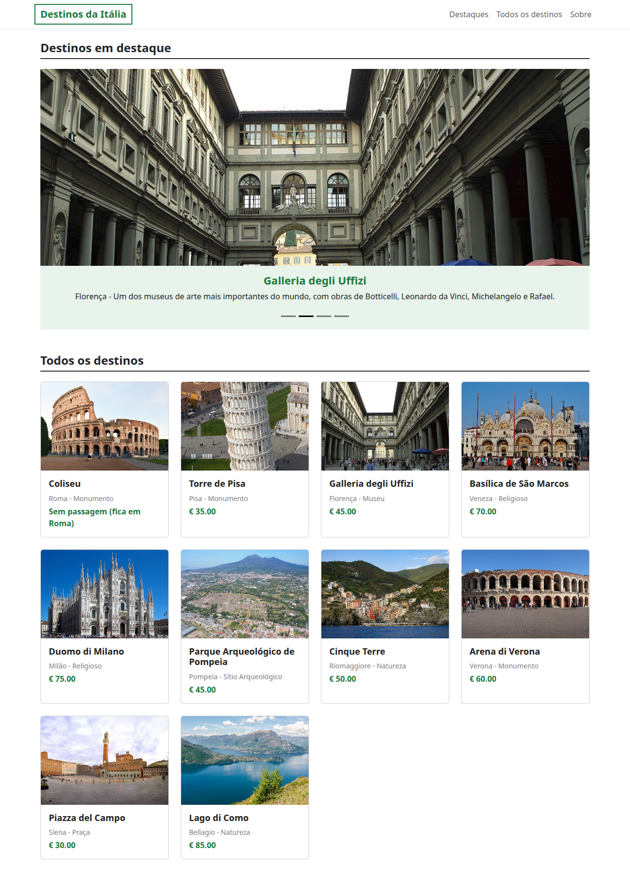
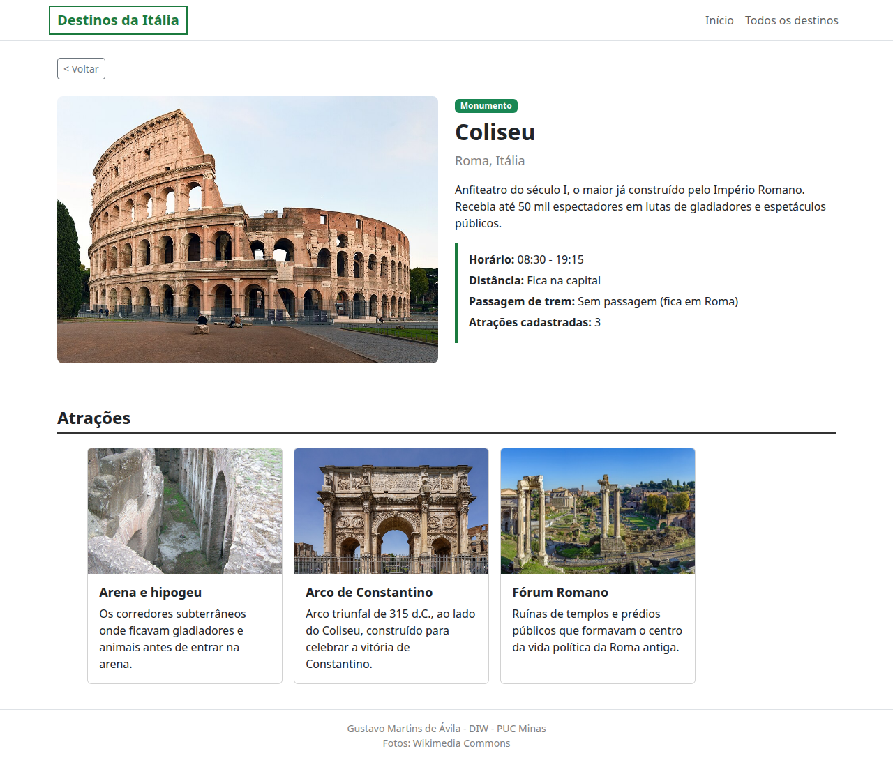

# Trabalho Prático - Semana 11

Nesta atividade, vamos evoluir o projeto em que estamos trabalhando nesse semestre, acrescentando a página de detalhes.

## Informações Gerais

- Nome: Gustavo Martins de Ávila
- Matricula: 912341
- Projeto: **Destinos da Itália**. A home-page mostra os destinos turísticos em um carrossel de destaques e em cards. Ao clicar na imagem ou no nome de um destino, o usuário vai para `detalhes.html?id=N`, que lê o `id` da query string, busca o destino na estrutura JSON do `app.js` e mostra todas as informações dele (categoria, cidade, descrição, horário, distância de Roma, preço da passagem de trem) e as fotos das atrações do lugar.

## Estrutura

```
public/
├── index.html      home-page: carrossel de destaques, cards de todos os destinos e informações do aluno
├── detalhes.html   detalhes de um destino (detalhes.html?id=N) e fotos das atrações
├── styles.css
└── app.js          estrutura JSON + funções que montam as duas páginas
```

## Prints do trabalho

### Home-page



### Tela de detalhes



## Dados em JSON

A estrutura completa está no início do `app.js` (`const data`). São 10 destinos (`destinos`), 30 atrações (`atracoes`, 3 por destino, ligadas pelo campo `destinoId`) e os dados do aluno (`aluno`). Exemplos:

```json
{
  "destinos": [
    {
      "id": 1,
      "nome_local": "Coliseu",
      "cidade": "Roma",
      "distancia_capital": 0,
      "preco_passagem": 0,
      "informacoes_local": "Anfiteatro do século I, o maior já construído pelo Império Romano. Recebia até 50 mil espectadores em lutas de gladiadores e espetáculos públicos.",
      "imagem": "https://thumb.wikimedia.org/wikipedia/commons/thumb/d/de/Colosseo_2020.jpg/960px-Colosseo_2020.jpg",
      "categoria": "Monumento",
      "hora_funcionamento": "08:30 - 19:15",
      "destaque": true
    },
    {
      "id": 2,
      "nome_local": "Torre de Pisa",
      "cidade": "Pisa",
      "distancia_capital": 350,
      "preco_passagem": 35,
      "informacoes_local": "Campanário do século XII com quase 60 metros de altura, famoso pela inclinação causada pelo solo instável. Fica na Piazza dei Miracoli.",
      "imagem": "https://thumb.wikimedia.org/wikipedia/commons/thumb/4/4b/Italy_-_Pisa_-_Leaning_Tower.jpg/960px-Italy_-_Pisa_-_Leaning_Tower.jpg",
      "categoria": "Monumento",
      "hora_funcionamento": "09:00 - 20:00",
      "destaque": false
    }
  ],
  "atracoes": [
    {
      "id": 1,
      "destinoId": 1,
      "nome": "Arena e hipogeu",
      "descricao": "Os corredores subterrâneos onde ficavam gladiadores e animais antes de entrar na arena.",
      "imagem": "https://thumb.wikimedia.org/wikipedia/commons/thumb/f/f7/Colosseum_hypogeum.JPG/960px-Colosseum_hypogeum.JPG"
    },
    {
      "id": 2,
      "destinoId": 1,
      "nome": "Arco de Constantino",
      "descricao": "Arco triunfal de 315 d.C., ao lado do Coliseu, construído para celebrar a vitória de Constantino.",
      "imagem": "https://thumb.wikimedia.org/wikipedia/commons/thumb/a/a3/Arch_of_Constantine_%28Rome%29_-_South_side%2C_from_Via_triumphalis.jpg/960px-Arch_of_Constantine_%28Rome%29_-_South_side%2C_from_Via_triumphalis.jpg"
    }
  ]
}
```
